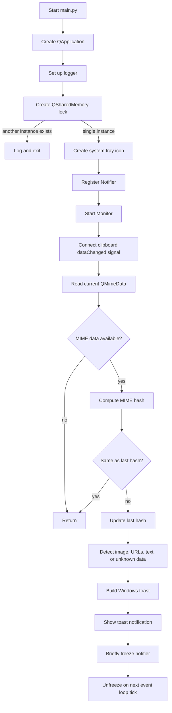

# ClipMonitor

ClipMonitor is a Windows clipboard watcher built with Python 3.12 and PySide 6. It monitors clipboard changes and shows a toast notification so the user can confirm that copied content was received.

## 1. Project Overview

ClipMonitor runs as a system tray application and stays active without a main window.

Verified behavior from the source code:

- Starts a single-instance Qt application and exits if another instance is already running.
- Installs a system tray icon with a Quit action.
- Watches the clipboard for `dataChanged` events.
- Deduplicates repeated clipboard states by hashing the MIME formats and payload.
- Sends Windows toast notifications for clipboard content changes.
- Handles text, URLs, images, and unknown clipboard content.
- Uses the application icon from `assets/icon.ico`.
- Registers an AppUserModelId in the current user registry so Windows toasts can be associated with the app.
- Writes application logs to a rotating log file next to the source code: `Clip Monitor.log`.

Notification behavior currently implemented in `notifier.py`:

- Image content is saved to a temporary PNG file and shown in the toast when possible.
- URL lists are rendered as text entries in the toast.
- Mixed image-plus-URL clipboard data is handled separately from plain text and plain URLs.
- Unknown clipboard formats are logged and still trigger a generic notification.

## 2. Flow Diagram



## 3. Quick Start

Requirements:

- Windows
- Python 3.12
- uv

Clone, install dependencies, and run the app:

```bash
git clone <repository-url>
cd clip_monitor
uv sync
uv run main.py
```

Build a packaged application with the provided PyInstaller spec:

```bash
uv sync --dev
uv run pyinstaller ClipMonitor.spec
```

You can find the final distribution at `dist/ClipMonitor/`.

## 4. Contributing & License

Before opening a pull request:

- Verify the app still starts from `main.py`.
- Verify the PyInstaller build still succeeds with `ClipMonitor.spec`.
- Check that clipboard notifications still behave correctly for text, URLs, images, and unknown content.

License: GNU General Public License v3.0 (GPL v3)